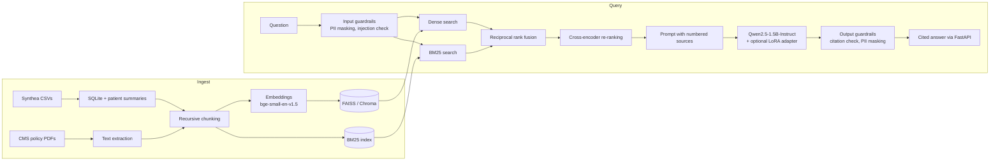

# Clinical & Policy Insight Assistant

An open-source Generative AI assistant that answers questions over **synthetic patient records
(Synthea)** and **public CMS medical policy documents**, with cited, grounded answers.

It combines a full **Retrieval-Augmented Generation (RAG)** pipeline with **LoRA fine-tuning**,
an **LLM evaluation** harness, guardrails, and a containerized **FastAPI** service.
Every model is open-source and runs from the Hugging Face Hub.

> All patient data is synthetic (generated by [Synthea](https://synthetichealth.github.io/synthea/)).
> No real patient information is used.

## Architecture



| Component | Choice | Why |
|---|---|---|
| Embeddings | `BAAI/bge-small-en-v1.5` | Strong retrieval quality at 384 dimensions; fast on CPU |
| Vector store | FAISS (`IndexFlatIP`) or Chroma | Exact cosine search; Chroma when you want persistence and metadata filters |
| Keyword search | BM25 (`rank-bm25`) | Catches exact terms embeddings blur: drug names, codes, patient IDs |
| Fusion | Reciprocal rank fusion (k=60) | Combines dense and keyword rankings without tuning score scales |
| Re-ranker | `cross-encoder/ms-marco-MiniLM-L-6-v2` | Reads query and passage together; more precise than embeddings alone |
| Generator | `Qwen/Qwen2.5-1.5B-Instruct` | Small open instruct model that runs on CPU; swap for any chat model |
| Fine-tuning | LoRA / QLoRA with PEFT | Trains ~1% of parameters; adapter is a few MB |
| Tracking | MLflow | Logs every evaluation variant and the training run |

## Project layout

```
src/cia/
  ingest/synthea.py      Synthea CSV -> SQLite + per-patient summaries
  ingest/documents.py    CMS policy PDFs/text -> documents
  chunking.py            recursive chunking with overlap
  embeddings.py          sentence-transformers embedder (+ offline hashing embedder)
  vectorstore.py         FAISS, Chroma and NumPy stores
  retrieval.py           BM25, reciprocal rank fusion, cross-encoder re-ranking
  guardrails.py          PII masking, injection checks, citation enforcement
  prompts.py             grounded, citation-required prompts
  llm.py                 Hugging Face generator with optional LoRA adapter
  rag.py                 the RAG pipeline
  build_index.py         CLI: build the index
  finetune/              QA-pair generation + LoRA training
  eval/                  metrics + MLflow-tracked variant comparison
  api/app.py             FastAPI service
tests/                   unit tests (no model downloads needed)
```

## Quickstart

```bash
python -m venv .venv && source .venv/bin/activate
make install                 # all dependencies
make data                    # download Synthea; then add CMS policy PDFs to data/raw/policies/
make index                   # chunk, embed and index everything
make serve                   # API on http://localhost:8000/docs
```

Ask a question:

```bash
curl -s localhost:8000/ask -H 'Content-Type: application/json' \
  -d '{"question": "What active conditions does patient <synthea-id> have?"}' | jq
```

Each answer cites its sources by number, and the response lists those sources with snippets.
If the retrieved context doesn't contain the answer, the assistant says so instead of guessing.

### Running on a MacBook Air / Apple Silicon

Models run on the Mac's GPU (MPS) automatically. Use the lighter laptop config
(Qwen2.5-0.5B, 200 patients), which fits in 8 GB of memory:

```bash
export CIA_CONFIG=configs/config.mac.yaml
make index && make serve
```

Fanless Macs slow down during long runs, so train the LoRA adapter on a free Colab GPU and
copy `models/lora-adapter/` back. `--qlora` needs an NVIDIA GPU and won't work on a Mac.

## Fine-tuning with LoRA

```bash
make finetune-data   # grounded QA pairs from Synthea (train/val + held-out eval questions)
make train           # LoRA on a GPU;  add --qlora for 4-bit QLoRA
```

`prepare_data` builds examples in the same RAG format used at inference time (context +
question -> cited answer), including negative examples where the context is about a different
patient and the correct answer is a refusal. Training and evaluation use **different
patients**, so there is no leakage. Set `llm.load_adapter: true` in `configs/config.yaml` to
serve the fine-tuned model.

A free Google Colab T4 GPU is enough to train the 1.5B model with `--qlora`.

## Evaluation

```bash
make eval
```

This runs each pipeline variant on the held-out questions and logs results to MLflow and
`results/eval_summary.md`:

| Variant | What it adds |
|---|---|
| `prompt_only` | Baseline: the LLM with no retrieval |
| `rag_dense` | Dense vector search |
| `rag_hybrid` | + BM25 and reciprocal rank fusion |
| `rag_hybrid_rerank` | + cross-encoder re-ranking |
| `rag_lora` | + LoRA fine-tuned generator |

Metrics:

- **Accuracy**: the answer contains every expected fact (or correctly refuses)
- **Token F1** against a reference answer
- **Groundedness**: share of answer sentences supported by retrieved context
- **Hallucination rate**: share of answers with any unsupported sentence
- **Retrieval recall@k**: whether the right source was retrieved
- **p50 latency**

Add your own policy questions using `eval/policy_questions.example.jsonl` as a template.

### Results

Run `make eval` and paste `results/eval_summary.md` here. Report the numbers you actually
measure, along with the hardware and the number of questions.

## Guardrails

- **Input:** length limit, prompt-injection phrase detection, PII masking (SSN, phone, email,
  MRN, street address) before text reaches the model.
- **Output:** answers must cite retrieved passages; uncited answers, or answers citing a passage
  that wasn't retrieved, are replaced with a refusal. PII is masked again on the way out.
- **No medical advice:** the system prompt restricts answers to what the sources say.

## Tests and CI

```bash
make dev && make test
```

The tests use a small hashing embedder and a fake LLM, so they run in seconds with no model
downloads. GitHub Actions runs lint and tests on Python 3.10 to 3.12, then builds the Docker image.

## Docker and AWS

```bash
docker compose up --build    # API on :8000, MLflow UI on :5000
```

See [`infra/aws/README.md`](infra/aws/README.md) to deploy the container to AWS App Runner or ECS.

## Built with

Python, Hugging Face Transformers, sentence-transformers, PEFT, FAISS, Chroma, rank-bm25,
FastAPI, MLflow, Docker, GitHub Actions, and Synthea.
